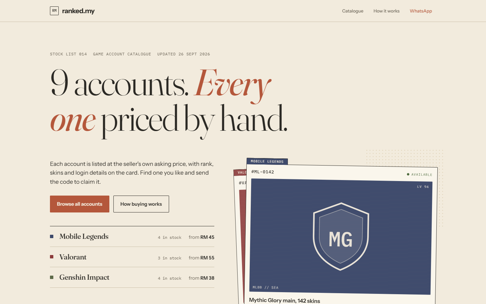
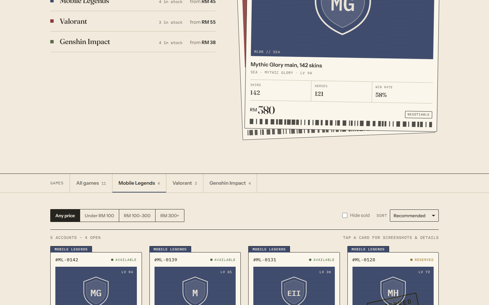
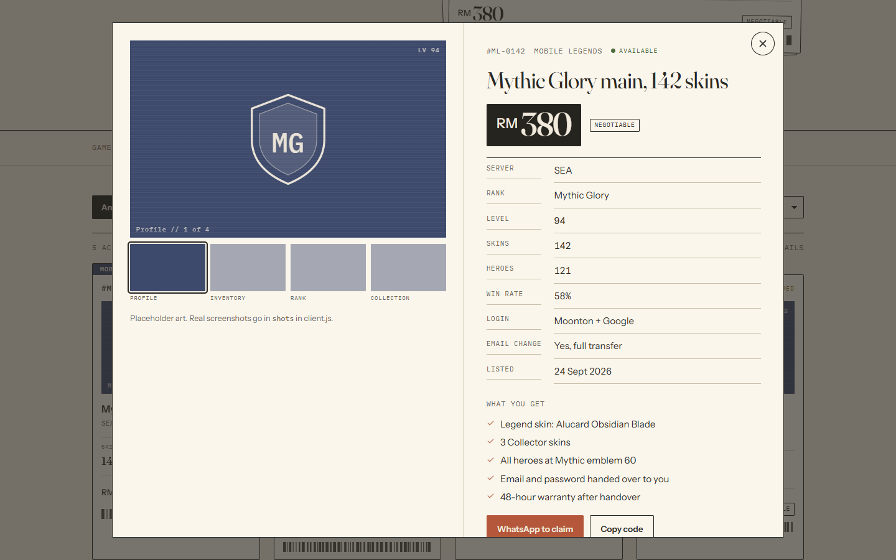
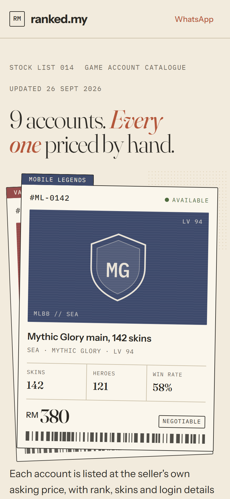

# 🎮 Game Account Catalogue

> A one-page stock list for a seller of game accounts (Mobile Legends, Valorant, Genshin Impact in the sample data). Buyers filter by game and price, open an account's full details, and claim it over WhatsApp with its code.

**Status:** Private repository. Source code available on request (interviews, review, collaboration).

The seller name and stock in the screenshots are sample data.

---

## What it does

1. **Game index.** The hero lists each game with how many accounts are in stock and the lowest price.
2. **Filter and sort.** By game, by price band (under RM 100, RM 100 to 300, RM 300+), by sort order, and hide sold accounts.
3. **Account files.** Each account is a card with rank, skins, heroes and win rate; opening it shows screenshots, the full details, a "what you get" checklist and the warranty.
4. **Claim.** "WhatsApp to claim" opens a chat with the account code already filled in, or copies the code when no number is set. Reserved and sold accounts are marked as such.

---

## Screenshots

| | |
|---|---|
|  **Game index with stock and prices** |  **Filter by game and price** |
|  **Account details and checklist** |  **On a phone** |

---

## Tech stack

- **HTML, CSS and vanilla JavaScript**, no framework and no build step
- Visual style carried over from my thrifted.af drop page (paper texture, serif headlines)

---

## Key engineering details

- **One file per client.** Everything that changes between sellers, the brand name, accent colour, WhatsApp number, games and the account list, lives in `client.js`. The page and its logic stay identical, so setting up a new seller is copying a folder and editing one file.
- **Safe rendering of seller data.** Every value from the client file is escaped before it reaches the page, so a stray `<` in an account title cannot break the layout.
- **Keyboard-friendly detail view.** The account dialog is a native `<dialog>`, with arrow keys to step between accounts and a click outside to close.

---

## Interested in the code?

The repository is private. If you would like to see the source, feel free to reach out.
